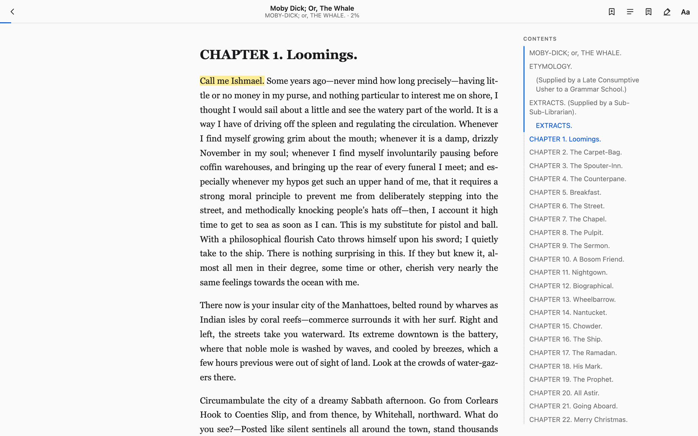

<p align="center">
  
</p>

<h1 align="center">neolib</h1>

<p align="center">
  <strong>A self-hosted, browser-first book reader for your EPUB and comic library.</strong><br>
  One Go binary. One SQLite database. Your books, your server.
</p>

<p align="center">
  <a href="https://go.dev/"></a>
  <a href="https://sqlite.org/"></a>
  <a href="#quick-start"></a>
  <a href="LICENCE"></a>
</p>

<p align="center">
  
</p>

<p align="center"><sub>The reader with a highlight and the optional side table of contents. <em>Moby-Dick</em> text via Project Gutenberg.</sub></p>

neolib turns a folder of books into a private reading library you open in a
browser. Import EPUBs and comic archives, read with themes, bookmarks, and
highlights, and pick up on another device where you left off. No desktop app,
no cloud account, no telemetry.

## Features

- **A comfortable reader.** Auto-hiding toolbar, table of contents, bookmarks,
  highlights, reading progress, and a distraction-free text column with an
  optional side table of contents and progress rail. Themes (auto, light,
  sepia, dark), typeface, text size, line spacing, and reading width apply
  before first paint and are saved to your account.
- **Highlights that stay anchored.** Bookmarks and highlights are stored as
  stable locators, so they survive reloads and follow you across devices.
  Highlights come in four colors; the primary painting path uses the CSS
  Custom Highlight API and never rewrites the book DOM, with a `<mark>`
  fallback for older browsers.
- **Resume anywhere.** Reading position, bookmarks, highlights, and display
  settings live on your server and sync across devices. The current position
  is also cached locally, so a dropped connection does not lose your place.
- **Import what you have.** EPUB, CBZ, and CBR are accepted. Comic archives
  are converted to EPUB at import, so they use the same reader and storage as
  other books. Page images are ordered naturally (`2.jpg` before `10.jpg`),
  and `ComicInfo.xml` supplies series, issue, author, publisher, date, and
  language metadata. Encrypted CBR archives are not supported.
- **No duplicate books.** Books are immutable and content-addressed by
  SHA-256; importing the same file twice is a no-op.
- **Works without JavaScript.** The reader page degrades to a plain, readable
  book with its table of contents. JavaScript adds the toolbar, sidebar,
  annotations, and live progress.
- **Boring to host.** One Go binary with embedded assets and embedded SQLite
  (no CGO), argon2id passwords, and a single `./data` directory to back up.
  No external services and no telemetry.

## Quick start

**Requirements:** [Go 1.27+](https://go.dev/) and `make` (or run the Go
commands directly).

```sh
git clone https://github.com/lassegit/neolib.git
cd neolib
make start
```

Open <http://localhost:8080>. The first visit goes to `/signup` to create the
account; after that, registration is closed by default.

`make start` builds the server and runs it in the background, so it keeps
running after you close the terminal. Logs go to `neolib.log`.

| Command | What it does |
| --- | --- |
| `make start` / `make stop` | Build and start in the background / stop the background server |
| `make dev` | Run the development server in the foreground |
| `make logs` | Follow the background server log |
| `make test` / `make vet` / `make fmt` | Test / vet / format the Go code |
| `make build` | Compile the `neolib` binary |
| `make clean-data` | Delete `./data` (destructive) |

Without `make`, the equivalent is `go build -o neolib ./cmd/neolib && ./neolib`
(or `go run ./cmd/neolib` for development).

## Managing books

Books can be removed from **Settings → Delete books**. The bulk page selects
one or more books at a time, and deleting a book also removes its stored EPUB
file, bookmarks, highlights, and reading progress from this server.

Book details live in the reader's **About this book** panel, where the title
and author can be edited and the stored EPUB downloaded.

## Configuration

Data lives in `./data` by default: the SQLite database, immutable EPUB files,
and temporary uploads. The server reads these environment variables:

| Variable | Default | Purpose |
| --- | --- | --- |
| `NEOLIB_ADDR` | `:8080` | HTTP listen address |
| `NEOLIB_DATA_DIR` | `./data` | Database, books, and temporary uploads |
| `NEOLIB_ALLOW_SIGNUP` | `auto` | `auto` (first user only), `true`, or `false` |
| `NEOLIB_SECURE_COOKIES` | `auto` | `auto` (HTTPS requests), `true`, or `false` |
| `NEOLIB_MAX_UPLOAD_MB` | `512` | Maximum request body size for imports |

For example:

```sh
NEOLIB_ADDR=127.0.0.1:9000 NEOLIB_DATA_DIR=/srv/neolib make start
```

When exposing neolib outside your network, put it behind a TLS-terminating
reverse proxy. Cookies are marked `Secure` automatically for HTTPS requests
with the default `NEOLIB_SECURE_COOKIES=auto`.

## Documentation

- [TECH_SPEC.md](TECH_SPEC.md) — architecture, data model, locators, sync, and plugin design
- [docs/READER_UI.md](docs/READER_UI.md) — reader UI and interaction design
- [docs/LOCATORS.md](docs/LOCATORS.md) — stable, shareable references to book locations

## Status

neolib is under active development. The current build covers the core library
and reader. Plugin and theme extensions, PWA offline support, OPDS, and
packaged releases are on the roadmap in [TECH_SPEC.md](TECH_SPEC.md).

## Contributing

Bug reports and pull requests are welcome. Run `make test` and `make vet`
before sending a change. For anything larger than a bug fix, open an issue
first so the design can be discussed.

## Book sources

Looking for something to read? [Project Gutenberg](https://www.gutenberg.org/)
has thousands of public-domain EPUBs, and
[Standard Ebooks](https://standardebooks.org/) publishes carefully edited
ones. Your local library is also a good place to look.

## License

Released under the [MIT License](LICENCE).
